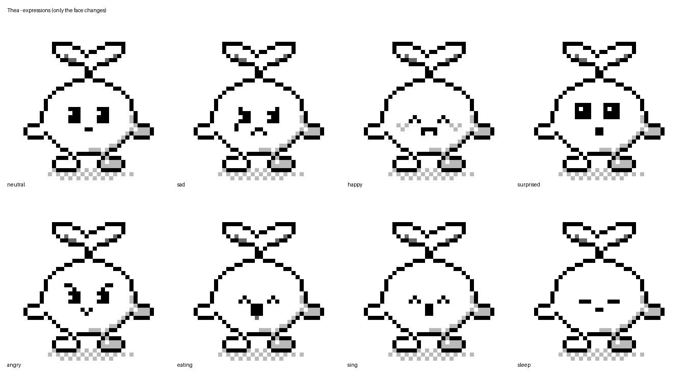

# Thea

A tiny pixel companion who lives on your Windows desktop. Round body, two-leaf
sprout, one-pixel line work. Black and white only, with a little dithered gray
when she blushes or sits in her own shadow.

She is drawn procedurally on a 40 x 40 pixel grid, not loaded from images, so
every frame is crisp at any scale. At the default scale of 5 she is 200 px tall.

```
python run.py          # start her
python run.py --preview  # write contact sheets to out/ and exit
```



## Setup

Python 3.10+ on Windows 10/11.

```bat
python -m venv .venv
.venv\Scripts\python.exe -m pip install -r requirements.txt
.venv\Scripts\python.exe run.py
```

Or double-click **run.bat** after the virtual environment exists. It launches
with `pythonw`, so there is no console window. Launching is always manual; there
is no start-with-Windows entry.

`PySide6` is the only real runtime dependency. `numpy` and `sounddevice` power
the chiptune voice, and `Pillow` is used only by the dev tools. If
`sounddevice` or an output device is missing she simply becomes silent.

## Controls

| Gesture | What happens |
| --- | --- |
| Hover, then **Space** | She runs toward the cursor's side of her body and hops when she reaches it |
| **Click** | A small hop |
| **Double-click** | Super happy: hearts, a wide smile, blush |
| **Drag** | Pick her up. She looks surprised while held |
| **Drop in the top 16% of the screen** | Feeding shelf — she eats, crumbs and all |
| **Fling and release** | Thrown with the pointer's velocity, then gravity takes over |
| **Hold for more than 4 s** | She gets angry on release |
| **Right-click** / tray icon | Menu: Feed, Sing, Play, Numbers, Sleep/wake, Quit |

Wake her by clicking or pressing Space if she has dozed off on her own.

The global Space key is swallowed **only** while the cursor is actually inside
her silhouette. Everywhere else, including one pixel outside her outline, the
key passes straight through to whatever you were typing in. This is a low-level
Windows hook (`WH_KEYBOARD_LL`) running in-process; no helper executable is
installed.

## Behaviour

- **Moods** — fullness, joy and energy drift down with time. Empty stomach means
  a sad face and a falling tear; a very happy mood means the happy face; being
  held too long means anger, with steam.
- **Rest** — leave her alone long enough and, when tired, she falls asleep and
  recovers energy. Space or a click wakes her with a startled "!".
- **Persistence** — mood numbers, meals eaten and her birthday are stored in
  `%APPDATA%\Thea\state.json`, written every 10 seconds and on quit.
- **Overlay** — the window is a small always-on-top, frameless, translucent
  panel that follows her. It is made hit-transparent (`WS_EX_TRANSPARENT`)
  whenever the cursor is not on her silhouette, so clicks, drags and text
  selection in other apps behave exactly as if she were not there.

## Art direction

The look is a closed system on purpose:

- Only black `#000000`, paper `#ffffff`, shade `#b9b9b9` and deep `#696969`.
  Blush and the contact shadow are 50% checkerboard dither, not a new tone.
- The body is one continuous outline with a single inset shade along the
  lower-right edge. The only interior line work is one vein per leaf.
- Expressions may change **only** the face and the emotion indicators outside
  the body. Silhouette, sprout, hands, feet, proportions and outline weight are
  frozen. `tests/test_rig.py` enforces this: every expression must paint inside
  the face rectangle (x 11..27, y 20..29) and must leave the alpha channel
  bit-identical to the neutral body.
- Faces drawn: neutral, sad, happy, surprised, angry, plus eating, singing and
  sleeping. Indicators (heart, tear, bang, steam, zzz, note, sparkle, crumb,
  dust) live in `thea/particles.py` and are pixel glyphs scaled at draw time.

To review the art without starting the overlay:

```bat
.venv\Scripts\python.exe run.py --preview
```

writes `out/expressions.png`, `out/poses.png` and `out/thea_1x.png` at 8x.

## Layout

```
run.py                 entry point, Qt setup, icon
thea/
  config.py            timing, physics, overlay padding
  palette.py           the four values + checkerboard
  rig.py               procedural body, silhouette, outline, shading
  expressions.py       faces, clipped to the face rect
  animation.py         Thea: state machine, physics, render()
  physics.py           pure motion helpers (tested)
  input.py             tap / double-tap / drag / throw interpretation
  particles.py         emotion indicators and effects
  stats.py             mood numbers and state.json
  audio.py             numpy chiptune -> sounddevice
  menu.py              1-bit popup menu
  window.py            the transparent overlay, tray, key hook wiring
tools/
  keyhook.py           ctypes WH_KEYBOARD_LL Space hook
  preview.py           contact sheets
  make_icon.py         assets/thea.ico from the sprite
  shot.py              screenshot helper for visual QA
tests/                 rig invariants, physics, input, animation
```

Hit tests use the actual silhouette mask, not the 40 x 40 square, so the cursor
is "over" her only on her body and sprout.

## Tests

```bat
.venv\Scripts\python.exe -m pytest -q
```

35 tests cover:

- the face-rect rule and body/alpha invariance across all eight expressions
- expression distinctness and RGBA output
- clamping, edge bouncing, throw velocity and the feeding zone
- single vs double tap, drag detection, throw samples
- state transitions: run, jump-land, happy timeout, eating, hunger, sleep/wake,
  hold-time anger and contiguous frame output

## Dev self-test

```bat
set THEA_SELFTEST=1
.venv\Scripts\python.exe run.py
```

It starts the overlay, moves the cursor onto her, checks hover and
click-through, synthesises a Space key press, prints state/hook/frame numbers
and quits. Useful for verifying the global hook on a new machine.

## Known limits

- Windows only (Win32 hit-transparency and the keyboard hook).
- Single monitor: she uses the primary screen's available area.
- The low-level hook is inert while an elevated (admin) window has focus; this
  is a Windows security boundary, not a bug.
- Her mood decays while the app is closed only in the sense that nothing
  happens; on next launch the stored numbers resume where they were.
- The keyboard hook grabs Space only; other shortcuts are untouched.
